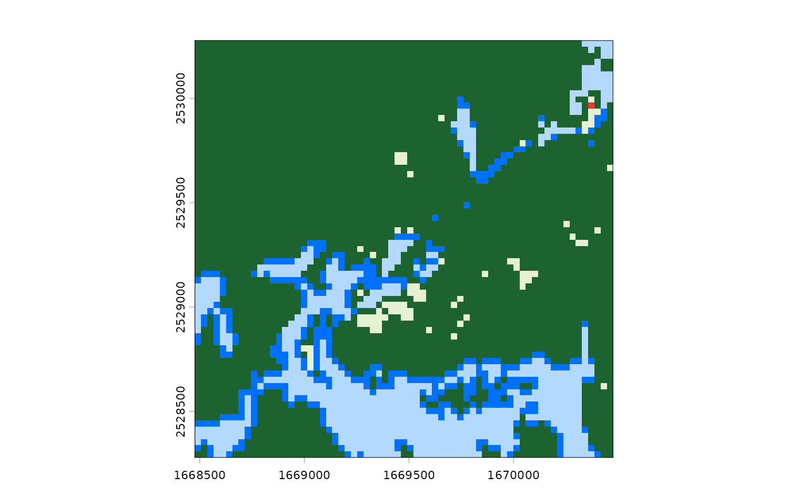
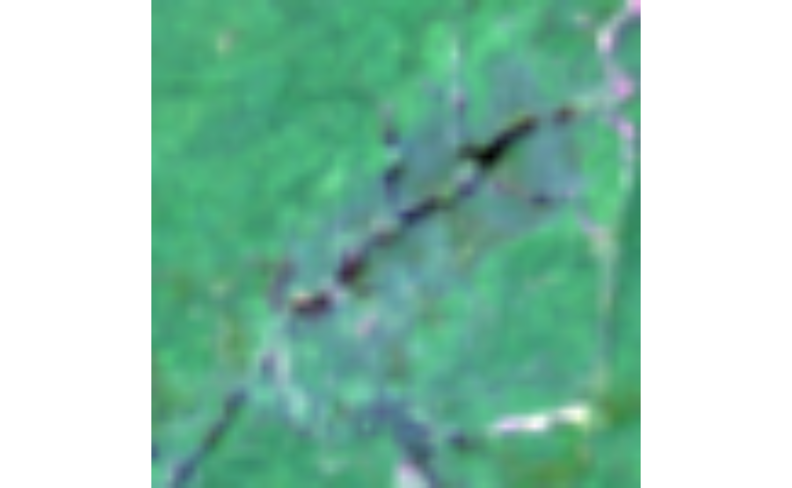
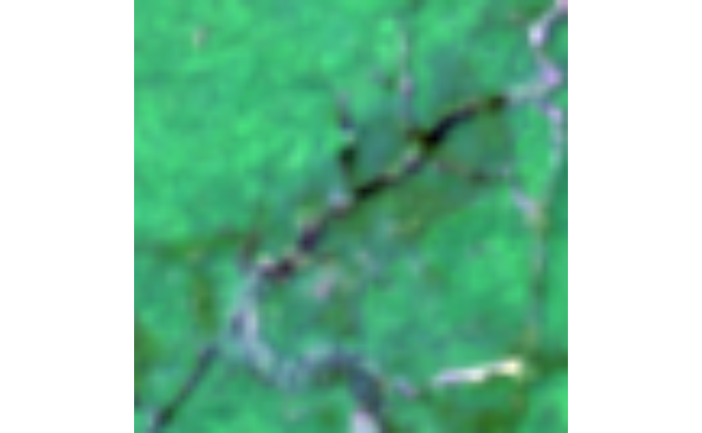
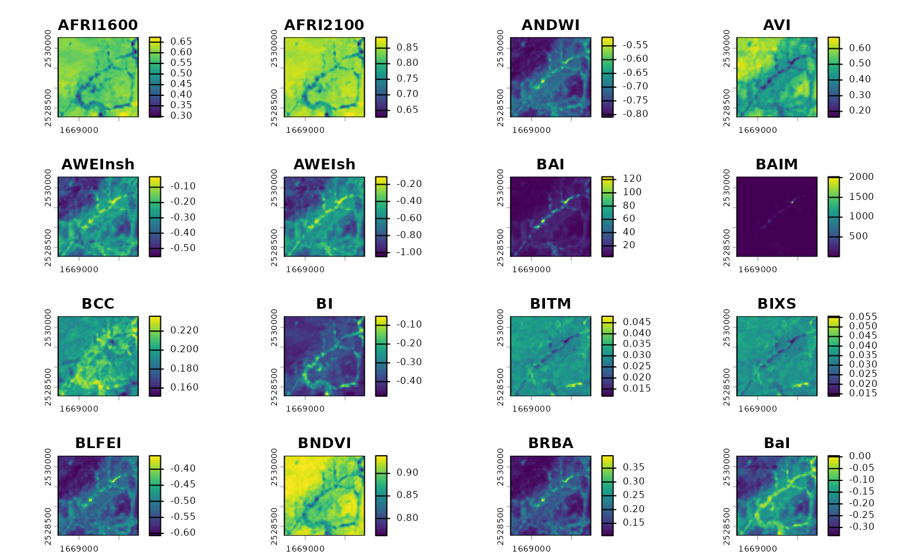

# How can I...?

This vignette aims to provide a “cookbook” walking through common use
cases and code patterns for rsi. If you’ve got a problem that it seems
like rsi *should* be able to solve, hopefully this document can help –
otherwise, [open an
issue](https://github.com/Permian-Global-Research/rsi/issues) and we’ll
see if we can get you started! And if you’ve got a use case that took
you a second to figure out, please feel free to open a PR to add it as
an example to this document.

With that introduction out of the way, we’ll go ahead and load rsi:

``` r
library(rsi)
```

And start answering: How can I…

## Get one composite per year, month, or other interval?

If you’re looking to get separate files for several intervals, you’ll
need to call
[`get_stac_data()`](https://permian-global-research.github.io/rsi/dev/reference/get_stac_data.md)
separately for each of those intervals. The easiest way to do this is
through something like [`vapply()`](https://rdrr.io/r/base/lapply.html)
or a for-loop. Iterate along your intervals of interest, construct your
`start_date` and `end_date` inside of each iteration, and call
[`get_stac_data()`](https://permian-global-research.github.io/rsi/dev/reference/get_stac_data.md)
using those dates as arguments:

``` r
aoi <- sf::st_point(c(-74.912131, 44.080410))
aoi <- sf::st_set_crs(sf::st_sfc(aoi), 4326)
aoi <- sf::st_buffer(sf::st_transform(aoi, 5070), 1000)

downloaded_years <- vapply(
  2018:2020,
  function(year) {
    get_stac_data(
      aoi = aoi,
      start_date = glue::glue("{year}-01-01"),
      end_date = glue::glue("{year}-12-31"),
      asset_names = "lcpri",
      stac_source = "https://planetarycomputer.microsoft.com/api/stac/v1",
      collection = "usgs-lcmap-conus-v13",
      output_filename = file.path(tempdir(), glue::glue("{year}.tif"))
    )
  },
  character(1)
)

downloaded_years
#> [1] "/tmp/RtmpMzOWU3/2018.tif" "/tmp/RtmpMzOWU3/2019.tif"
#> [3] "/tmp/RtmpMzOWU3/2020.tif"
```

This ensures that
[`get_stac_data()`](https://permian-global-research.github.io/rsi/dev/reference/get_stac_data.md)
is run using the same arguments each time, so your outputs should be
standardized across each interval!

``` r
invisible(lapply(lapply(downloaded_years, terra::rast), terra::plot))
```



## Get each distinct item that matches a query, without compositing?

If we want to download the individual STAC items that are returned by
our query, we can set the `composite_function` argument to `NULL`. This
will return one file per STAC item, with the `datetime` element of the
item appended to the filename if it exists (and a sequential identifier
if it doesn’t):

``` r
aoi <- sf::st_point(c(-74.912131, 44.080410))
aoi <- sf::st_set_crs(sf::st_sfc(aoi), 4326)
aoi <- sf::st_buffer(sf::st_transform(aoi, 5070), 1000)

our_imagery <- get_landsat_imagery(
  aoi,
  start_date = "2023-06-01",
  end_date = "2023-07-01",
  output_filename = tempfile(fileext = ".tif"),
  composite_function = NULL
)

our_imagery
#> [1] "/tmp/RtmpMzOWU3/file2d8c7897d049_2023-06-28T154415.862937Z.tif"
#> [2] "/tmp/RtmpMzOWU3/file2d8c7897d049_2023-06-20T154419.579981Z.tif"
#> [3] "/tmp/RtmpMzOWU3/file2d8c7897d049_2023-06-12T154413.224112Z.tif"
#> [4] "/tmp/RtmpMzOWU3/file2d8c7897d049_2023-06-04T154412.531019Z.tif"
```

Each of these files will then contain the assets corresponding to that
individual STAC item:

``` r
terra::rast(our_imagery[[2]], lyrs = c("R", "G", "B")) |>
  terra::stretch() |>
  terra::plotRGB()
```



``` r
terra::rast(our_imagery[[4]], lyrs = c("R", "G", "B")) |>
  terra::stretch() |>
  terra::plotRGB()
```



## Filter the imagery I download by cloud cover (or other metadata)?

If you want to refine the outputs from your STAC query, the best
approach is to write a custom query function using CQL2. CQL2 is a
complicated topic, which is covered in a bit more detail both [in the
Downloading Data
vignette](https://permian-global-research.github.io/rsi/articles/Downloading-data-from-STAC-APIs-using-rsi.html#using-cql2-to-refine-queries-to-stac-apis)
as well as in [the STAC website’s
tutorials](https://github.com/radiantearth/stac-site/blob/main/app/tutorials/r/2-using-rstac-and-cql2-to-query-stac-api/2-using-rstac-and-cql2-to-query-stac-api.en.md),
but at its core is a query language that lets us filter our results down
using a spatiotemporal area of interest as well as other item-level
metadata.

This requires knowing what metadata your STAC API provides for the items
you’re querying! Luckily, a good number of these fields are standardized
via the STAC standard and various STAC extensions. For instance, items
implementing the [electro-optical
extension](https://github.com/stac-extensions/eo) will have an
`eo:cloud_cover` field which we could use to filter the results of our
query.

Writing a query function to filter using this field might look like
this:

``` r
aoi <- sf::st_point(c(-74.912131, 44.080410))
aoi <- sf::st_set_crs(sf::st_sfc(aoi), 4326)
aoi <- sf::st_buffer(sf::st_transform(aoi, 5070), 1000)

custom_query_function <- function(bbox,
                                  stac_source,
                                  collection,
                                  start_date,
                                  end_date,
                                  limit,
                                  ...) {
  geometry <- rstac::cql2_bbox_as_geojson(bbox)
  datetime <- rstac::cql2_interval(start_date, end_date)

  request <- rstac::ext_filter(
    rstac::stac(stac_source),
    collection == {{ collection }} &&
      t_intersects(datetime, {{ datetime }}) &&
      s_intersects(geometry, {{ geometry }}) &&
      `eo:cloud_cover` < 50
  )
  rstac::items_fetch(rstac::post_request(request))
}
```

And we can use this to filter down how much data we’ll download! For
instance, we could download Landsat imagery for our area of interest
*without* using our new query function and setting `composite_function`
to `NULL`, so that we’ll get one file per Landsat image:

``` r
unfiltered_landsat_images <- get_landsat_imagery(
  aoi,
  start_date = "2023-06-01",
  end_date = "2023-09-01",
  # Only downloading one asset, because we aren't using this data for anything
  asset_names = landsat_band_mapping$planetary_computer_v1["red"],
  mask_function = NULL,
  mask_band = NULL,
  output_filename = tempfile(fileext = ".tif"),
  composite_function = NULL
)
length(unfiltered_landsat_images)
#> [1] 12
```

And we could compare that to a query using our custom query function, to
see how many images are filtered out by our CQL2 query:

``` r
filtered_landsat_images <- get_landsat_imagery(
  aoi,
  start_date = "2023-06-01",
  end_date = "2023-09-01",
  query_function = custom_query_function,
  asset_names = landsat_band_mapping$planetary_computer_v1["red"],
  mask_function = NULL,
  mask_band = NULL,
  output_filename = tempfile(fileext = ".tif"),
  composite_function = NULL
)
length(filtered_landsat_images)
#> [1] 7
```

We only wind up downloading about half the number of images!

## Calculate all possible indices using a certain data set?

Say you’ve got some imagery:

``` r
aoi <- sf::st_point(c(-74.912131, 44.080410))
aoi <- sf::st_set_crs(sf::st_sfc(aoi), 4326)
aoi <- sf::st_buffer(sf::st_transform(aoi, 5070), 1000)

our_imagery <- get_landsat_imagery(
  aoi,
  start_date = "2023-06-01",
  end_date = "2023-07-01",
  output_filename = tempfile(fileext = ".tif")
)
```

You want to calculate some indices from this imagery. Specifically, you
want to calculate all the indices you can from this imagery – you’re
doing some sort of machine learning/data mining work, and you want to
throw as many indices in the mix as possible.

To do that using
[`calculate_indices()`](https://permian-global-research.github.io/rsi/dev/reference/calculate_indices.md),
you’re going to need to only provide formulas for the indices that can
be calculated from your particular data source. We might look at the
columns available for filtering from
[`spectral_indices()`](https://permian-global-research.github.io/rsi/dev/reference/spectral_indices.md):

``` r
spectral_indices() |>
  head(1)
#> # A tibble: 1 × 9
#>   application_domain bands     contributor    date_of_addition formula long_name
#>   <chr>              <list>    <chr>          <chr>            <chr>   <chr>    
#> 1 vegetation         <chr [2]> https://githu… 2021-11-17       (N - 0… Aerosol …
#> # ℹ 3 more variables: platforms <list>, reference <chr>, short_name <chr>
```

It might seem like we’d want to use the `platforms` column here: we just
downloaded a bunch of data from the Landsat-OLI platform, so we probably
want to calculate indices that correspond to this platform.
Unfortunately, if we use
[`filter_platforms()`](https://permian-global-research.github.io/rsi/dev/reference/filters.md)
to do this filtering, we’ll get an error inside of
[`calculate_indices()`](https://permian-global-research.github.io/rsi/dev/reference/calculate_indices.md):

``` r
try(
  calculate_indices(
    our_imagery,
    filter_platforms(platforms = "Landsat-OLI"),
    output_filename = tempfile(fileext = ".tif")
  )
)
#> Error in eval(calc) : object 'gamma' not found
```

The issue is that a number of the indices in [the Awesome Spectral
Indices project](https://github.com/davemlz/awesome-spectral-indices)
have formulas that require additional data. You can see a list of them
in the ASI documentation described as “additional index parameters”, and
they range from wavelength values to exponentiation factors to weighting
parameters and so on.

If you care about using a specific index, then it’s your job to figure
out what extra parameters that index requires and how you’ll provide
them. The
[`spectral_indices()`](https://permian-global-research.github.io/rsi/dev/reference/spectral_indices.md)
table also includes a DOI to the authoritative reference (as listed in
the ASI project) which can hopefully help with this.

However, if you’re looking to automatically calculate just the indices
that don’t require external parameters, you can do that as well. Rather
than use
[`filter_platforms()`](https://permian-global-research.github.io/rsi/dev/reference/filters.md),
we’ll use
[`filter_bands()`](https://permian-global-research.github.io/rsi/dev/reference/filters.md)
to retrieve all the spectral indices that can be calculated using the
bands available in our raster.

Assuming you used one of the wrapper functions in rsi, like
`get_landsat_data()` or `get_sentinel2_data()`, your raster bands should
automatically be named to match the band names used in the ASI project.
That means we can pass the names of your raster directly to
[`filter_bands()`](https://permian-global-research.github.io/rsi/dev/reference/filters.md):

``` r
filter_bands(bands = names(terra::rast(our_imagery))) |>
  head(1)
#> # A tibble: 1 × 9
#>   application_domain bands     contributor    date_of_addition formula long_name
#>   <chr>              <list>    <chr>          <chr>            <chr>   <chr>    
#> 1 vegetation         <chr [2]> https://githu… 2021-11-17       (N - 0… Aerosol …
#> # ℹ 3 more variables: platforms <list>, reference <chr>, short_name <chr>
```

And we can pass the outputs of that function to
[`calculate_indices()`](https://permian-global-research.github.io/rsi/dev/reference/calculate_indices.md)
to only calculate this subset of indices:

``` r
calculate_indices(
  our_imagery,
  filter_bands(bands = names(terra::rast(our_imagery))),
  output_filename = tempfile(fileext = ".tif")
) |>
  terra::rast() |>
  terra::plot()
```


