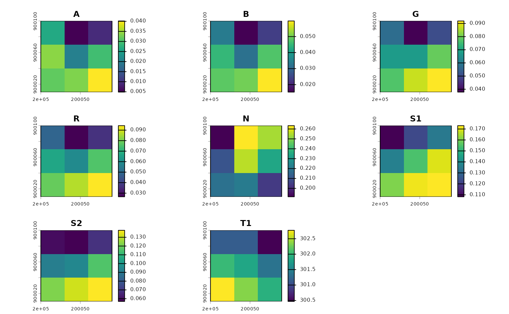
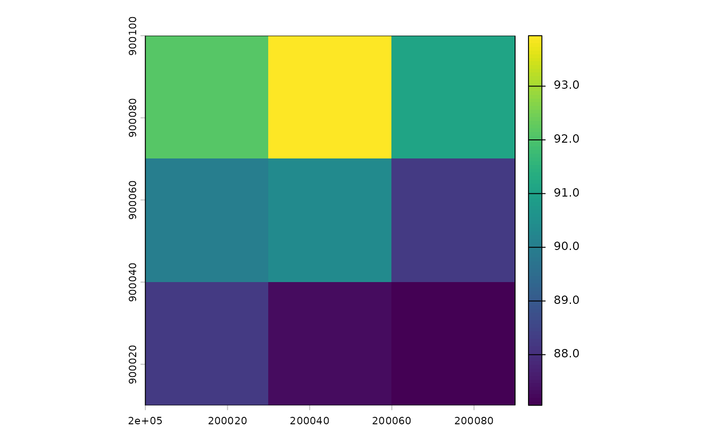
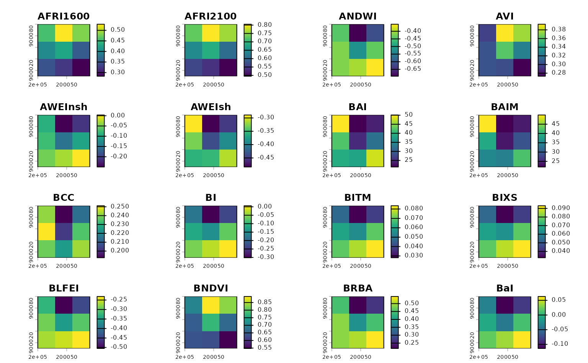
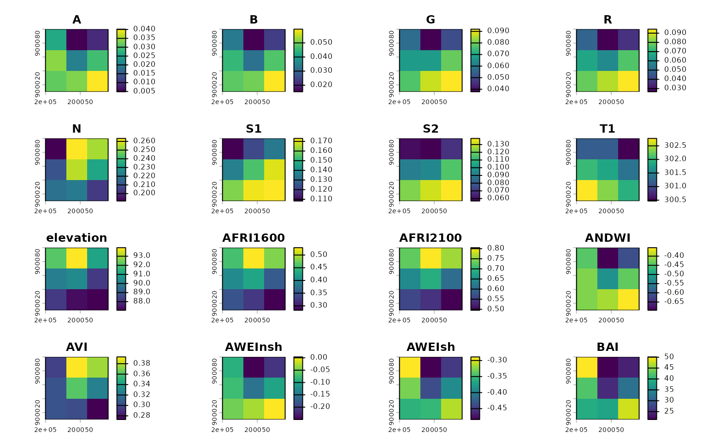

# A whirlwind tour of rsi

The rsi package aims to help you download data from STAC APIs, to
compute spectral indices from data, and to handle a handful of other
spatial data wrangling tasks. This vignette walks through the main
features of the package. Let’s start off by loading the package:

``` r
library(rsi)
```

## Downloading data

In order to download data from a STAC API, we’re going to need to
specify both a spatial and temporal area of interest. To define our
spatial area of interest, we’ll first mock up a small bounding box in
northern Massachusetts (in a planar CRS appropriate for the region):

``` r
our_aoi <- sf::st_bbox(
  c(xmin = 200000, ymin = 900000, xmax = 200100, ymax = 900100),
  crs = 26986
)
our_aoi <- sf::st_as_sf(sf::st_as_sfc(our_aoi))
sf::st_area(our_aoi)
#> 10000 [m^2]
plot(sf::st_geometry(our_aoi))
```


This is the area we’re going to download and process data for.

Out of the box, rsi includes a number of functions to make it easy to
download the most popular data sets from public STAC APIs. For instance,
the
[`get_landsat_imagery()`](https://permian-global-research.github.io/rsi/dev/reference/get_stac_data.md)
has a number of default arguments for downloading Landsat 8 and 9
imagery from Microsoft’s Planetary Computer. We’ll pass our spatial area
of interest along with a timeframe to this function, in order to get a
cloud-masked composite image of all Landsat acquisitions for our
spatiotemporal window. Let’s grab all the imagery from September 2023:

``` r
our_imagery <- get_landsat_imagery(
  our_aoi,
  "2023-09-01",
  "2023-09-30",
  output_filename = tempfile(fileext = ".tif")
)
our_imagery
#> [1] "/tmp/RtmpYBzmkw/file2f77426a8ef.tif"
```

If we wanted to, we could use
[`future::plan()`](https://future.futureverse.org/reference/plan.html)
here to specify a parallelization methodology to speed up downloads by
using multiple threads. We could also use
[`progressr::handlers()`](https://progressr.futureverse.org/reference/handlers.html)
to get a progress bar to report our download status.

By default,
[`get_landsat_imagery()`](https://permian-global-research.github.io/rsi/dev/reference/get_stac_data.md)
will download a composite of all bands available in Landsat 8 and 9
imagery for our timeframe:

``` r
terra::rast(our_imagery) |>
  terra::plot()
```



Notice that this composite has been cloud-masked (using the QA pixel
band) and rescaled (using the scale and offset specified in metadata
provided by the STAC endpoint) automatically. You can control these
behaviors via function arguments.

We’re also able to use rsi to download other data sets – for instance,
we could also grab a DEM for this area from Planetary Computer, using
the
[`get_dem()`](https://permian-global-research.github.io/rsi/dev/reference/get_stac_data.md)
function:

``` r
our_dem <- get_dem(our_aoi)
terra::rast(our_dem) |>
  terra::plot()
```



Under the hood, both of these functions (and their friends,
[`get_sentinel2_imagery()`](https://permian-global-research.github.io/rsi/dev/reference/get_stac_data.md)
and
[`get_sentinel1_imagery()`](https://permian-global-research.github.io/rsi/dev/reference/get_stac_data.md))
are powered by a lower-level
[`get_stac_data()`](https://permian-global-research.github.io/rsi/dev/reference/get_stac_data.md)
function, which should theoretically work with any imagery provided by
any STAC API, anywhere. These functions simply provide user-friendly
defaults to make it faster to get the data you care about.

## Finding spectral indices

In addition to these STAC-focused data-downloading functions, rsi also
has an interface to the [Awesome Spectral
Indices](https://github.com/awesome-spectral-indices/awesome-spectral-indices)
project via the
[`spectral_indices()`](https://permian-global-research.github.io/rsi/dev/reference/spectral_indices.md)
function:

``` r
spectral_indices() |>
  head()
#> # A tibble: 6 × 9
#>   application_domain bands     contributor    date_of_addition formula long_name
#>   <chr>              <list>    <chr>          <chr>            <chr>   <chr>    
#> 1 vegetation         <chr [2]> https://githu… 2021-11-17       (N - 0… Aerosol …
#> 2 vegetation         <chr [2]> https://githu… 2021-11-17       (N - 0… Aerosol …
#> 3 water              <chr [6]> https://githu… 2022-09-22       (B + G… Augmente…
#> 4 vegetation         <chr [2]> https://githu… 2021-09-20       (1 / G… Anthocya…
#> 5 vegetation         <chr [3]> https://githu… 2022-04-08       N * ((… Anthocya…
#> 6 vegetation         <chr [4]> https://githu… 2021-05-11       (N - (… Atmosphe…
#> # ℹ 3 more variables: platforms <list>, reference <chr>, short_name <chr>
```

This function attempts to grab the newest version of the spectral
indices JSON file from the ASI repo, and then stores that data in a
cache folder on your computer. If the downloading fails, the package
will fall back (with a warning) to use your possibly outdated cache
instead; if you don’t have a cache and can’t download the files, the
package will instead (with a different warning) resort to using a
packaged version of the indices file. This ensures that you’re always
getting the latest and greatest version of the ASI list possible, but
that the package can still be used without an internet connection.

There are also functions in rsi to sort through the ASI list of indices.
For instance, the
[`filter_platforms()`](https://permian-global-research.github.io/rsi/dev/reference/filters.md)
function can be used to, well, filter the list to only indices that can
be calculated from a given platform. For instance, to filter to only
indices that can be calculated using data from Landsat’s Operational
Land Imager:

``` r
filter_platforms(platforms = "Landsat-OLI") |>
  head()
#> # A tibble: 6 × 9
#>   application_domain bands     contributor    date_of_addition formula long_name
#>   <chr>              <list>    <chr>          <chr>            <chr>   <chr>    
#> 1 vegetation         <chr [2]> https://githu… 2021-11-17       (N - 0… Aerosol …
#> 2 vegetation         <chr [2]> https://githu… 2021-11-17       (N - 0… Aerosol …
#> 3 water              <chr [6]> https://githu… 2022-09-22       (B + G… Augmente…
#> 4 vegetation         <chr [4]> https://githu… 2021-05-11       (N - (… Atmosphe…
#> 5 vegetation         <chr [4]> https://githu… 2021-05-14       sla * … Adjusted…
#> 6 vegetation         <chr [2]> https://githu… 2022-04-08       (N * (… Advanced…
#> # ℹ 3 more variables: platforms <list>, reference <chr>, short_name <chr>
```

There’s an equivalent function to filter indices based upon the bands
that require. For instance, we can filter the list to only indices that
use the red and blue band of images:

``` r
filter_bands(bands = c("R", "B"))
#> # A tibble: 2 × 9
#>   application_domain bands     contributor    date_of_addition formula long_name
#>   <chr>              <list>    <chr>          <chr>            <chr>   <chr>    
#> 1 vegetation         <chr [2]> https://githu… 2022-04-08       (R - B… Kawashim…
#> 2 vegetation         <chr [2]> https://githu… 2022-04-08       (R^2.0… Modified…
#> # ℹ 3 more variables: platforms <list>, reference <chr>, short_name <chr>
```

Arguments to these functions let you control whether you’re looking for
indices that match *all* platforms and bands you’ve specified, or *any*
of them.

## Calculating indices

But rsi doesn’t simply make these formulas available in R, it also helps
you compute these indices from imagery, via the
[`calculate_indices()`](https://permian-global-research.github.io/rsi/dev/reference/calculate_indices.md)
function. This function takes your imagery and a subset of
[`spectral_indices()`](https://permian-global-research.github.io/rsi/dev/reference/spectral_indices.md)
as arguments, and creates a raster containing all of those indices as an
output. We can use
[`filter_bands()`](https://permian-global-research.github.io/rsi/dev/reference/filters.md)
to quickly get a list of the indices we can compute from our Landsat
imagery, and then
[`calculate_indices()`](https://permian-global-research.github.io/rsi/dev/reference/calculate_indices.md)
to compute all 128 of those indices from our images:

``` r
our_indices <- calculate_indices(
  our_imagery,
  filter_bands(bands = names(terra::rast(our_imagery))),
  "our_indices.tif"
)
terra::rast(our_indices) |>
  terra::plot()
```



Note that
[`calculate_indices()`](https://permian-global-research.github.io/rsi/dev/reference/calculate_indices.md)
is evaluating the formulas in the `formula` column of the spectral
indices data frame as if they were code. These formulas are evaluated
inside of a very limited environment, which doesn’t have access to the
global environment or most R fixtures, which does *reduce* the amount of
harm malicious code could do:

``` r
evil_index <- spectral_indices()[1, ]
evil_index$formula <- "base::system('echo OHNO')"
try(
  calculate_indices(
    our_imagery,
    evil_index,
    tempfile(fileext = ".tif")
  )
)
#> Error in base::system : could not find function "::"
```

But it’s worth scanning your formulas before running
[`calculate_indices()`](https://permian-global-research.github.io/rsi/dev/reference/calculate_indices.md),
just to make sure you aren’t going to be accidentally running something
surprising!

## Stacking rasters

Last but not least, rsi also provides a way to combine disparate data
sets covering the same geographic region into a single VRT, quickly
creating a file that you can treat as a single raster without taking up
much additional storage space. This is a great way to create predictor
bricks from your indices and downloaded data which you can then use for
model fitting and prediction:

``` r
combined_layers <- stack_rasters(
  c(our_imagery, our_dem, our_indices),
  tempfile(fileext = ".vrt")
)

terra::rast(combined_layers) |>
  terra::plot()
```


